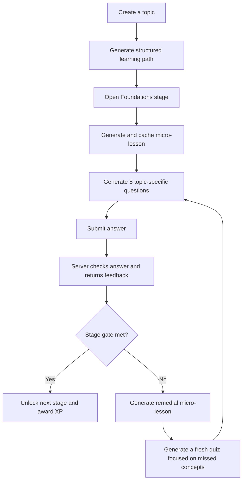

# AI Study Dungeon — v10 Topic Journey Engine

AI Study Dungeon is a React + Vite learning prototype with an Express/Gemini backend. The v10 focus is a real, topic-specific learning journey rather than a generic fallback quiz.

## Run locally

Requirements: Node.js 20+ and npm.

```bash
npm install
```

Copy `.env.example` to `.env`, add your Gemini API key, then run both processes:

```bash
npm run dev:all
```

- Frontend: http://localhost:5173
- API: http://localhost:3001/api/health

To run separately, use `npm run server` and `npm run dev` in two terminals. Never put the API key in React code or commit `.env`.

## Main flow



## API endpoints

- `GET /api/health` — backend, configured model and startup model check status.
- `POST /api/chat/stream` — NDJSON streaming AI Tutor.
- `POST /api/path/generate` — structured 5–6-stage learning path.
- `POST /api/lesson/generate` — 3–5 micro-lessons for a stage.
- `POST /api/quiz/generate` — 8–12 topic/stage-specific questions. Correct indices, answer guides, explanations and misconception notes stay on the server.
- `POST /api/quiz/answer` — checks an answer against the in-memory quiz session and returns feedback.
- `POST /api/answer/grade` — AI grading endpoint for written answers.
- `POST /api/remedial/generate` — remedial lesson targeted to missed concept tags.

The quiz answer-key store is in memory and expires after three hours; restarting the backend invalidates active quiz sessions. Generate a fresh question set after a session expires.

## Data and learning rules

- Local progress is stored under the versioned key `sd:v2`. Legacy prototype keys are read during migration.
- Custom topics store the generated stage map, stage index, cached lesson and answer-attempt evidence in browser local storage.
- XP is awarded for correct recorded battle answers, not for ordinary chat messages.
- A stage gate requires at least 8 recorded attempts, 75% accuracy (80% for the Boss), and correct responses across two distinct concept tags after an earlier wrong answer.
- A failed gate offers a targeted remedial lesson and requests a fresh quiz for the missed concepts.
- Export/import is available in Settings.

## QA commands

```bash
npm test
npm run lint
npm run build
npm run preview
```

`npm test` uses Node's built-in test runner for stage-gate rules, XP, difficulty helper logic, level math and review scheduling. `npm run lint` performs ESLint parsing checks. Run the commands locally after installation; the development environment used to prepare this archive could not complete `npm install`, so a Vite build and live browser flow could not be verified here.

## Known limitations in this prototype

- The frontend is still concentrated in `src/main.jsx`; a complete page/component split and route-level error boundaries remain to be done.
- Quiz attempts and topic progress are stored locally, not in a user-account database; progress does not sync across devices.
- The current generated quiz is mostly MCQ/true-false. Short-answer grading is supported but needs more end-to-end validation with real model responses.
- Adaptive difficulty helpers and spaced-review scheduling are present and tested as utilities, but they are not yet fully wired into a daily review queue or per-question generation loop.
- Daily streaks, real study-time tracking, full achievement progression, sound controls, theme switching, and comprehensive accessibility/e2e tests are not complete.
- The Gemini model is checked with a small request at backend startup. Model availability still depends on the configured API key, quota, account access and provider status.

### Subject knowledge map
Dungeons use stable subject IDs (Programming, Mathematics, ECE Core, Signals & Systems, and Unsorted). Custom topics store `subjectId`; the legacy text subject is retained only for compatibility. The backend exposes `POST /api/topic/classify` and `POST /api/topic/classify-batch`. If Gemini classification is unavailable, the frontend uses keyword rules and falls back to Unsorted rather than blocking the topic form. Subject cards open hash-addressable detail views, and attempt accuracy is only displayed when saved attempts exist.

Run checks with `npm test`, `npm run lint`, and `npm run build`. The test environment used while preparing this update did not have npm dependencies cached, and registry installation timed out; build/lint/browser verification therefore still needs to be run after `npm install` on the development machine.
