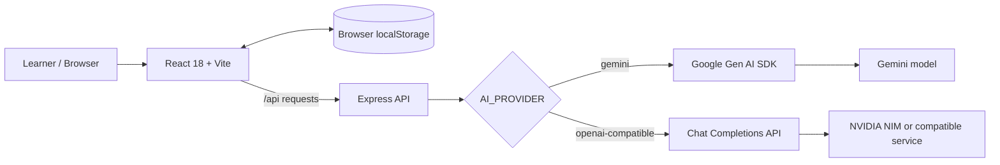
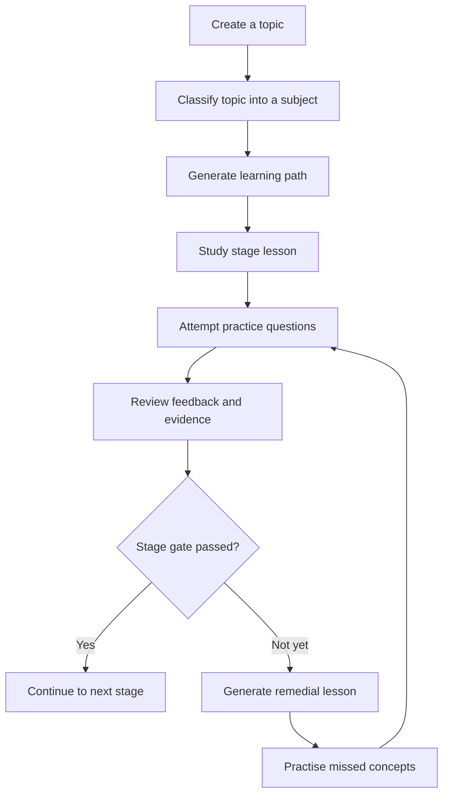

<div align="center">

# ⚔️ AI Study Dungeon

### Forge your knowledge. Conquer every concept.

An AI-powered, gamified study companion that transforms learning topics into structured journeys with AI-generated lessons, adaptive practice, quizzes, and personalized tutoring.


**[Application screenshots](#-application-preview) · [Features](#-features) · [Local installation](#-run-locally) · [Architecture](#-architecture)**

</div>

---

## ✨ About the project

AI Study Dungeon makes studying more active and structured. Instead of simply asking an AI a question and receiving a one-off answer, learners can create a topic, follow a staged learning path, study short lessons, practise with questions, and revisit concepts they have not yet understood.

The application combines a React-based learning interface with an Express API. AI-powered features run through a server-side provider adapter, while learner topics and progress are saved in the browser.

> AI Study Dungeon is a learning companion. It is designed to support—not replace—teachers, textbooks, and formal courses.

## 🖥️ Application preview

The following screenshots are from the running application.

### Dashboard

The home dashboard brings together the learner profile, XP, learning mission, focus areas, and shortcuts into the learning experience.


### Dungeons — Subject Knowledge Map

The Dungeons screen organizes subjects and their topics into a knowledge map, helping learners navigate their areas of study.


### Quiz Battle — Stage Practice

The practice screen presents stage-based questions, answer choices, hints, and learner evidence.


### AI Tutor

The AI Tutor provides a conversational learning companion for explanations, follow-up questions, and guided study.


---

## 🚀 Features

### 1. Topic Journey Engine
- Create a learning journey from a topic, level, goal, and optional notes.
- Generate an ordered path containing learning stages.
- Work through stage lessons with explanations, analogies, examples, and self-checks.
- Generate stage-specific practice questions.
- Use hints and feedback while attempting questions.
- Request remedial material focused on missed concepts.
- Progress through stage gates based on recorded learning evidence.

### 2. AI Tutor
- Chat with Dungeon Guide, the application's AI learning companion.
- Receive streamed responses in the tutor interface.
- Ask follow-up questions while maintaining conversation context.
- Use the configured server-side AI provider.

### 3. Subject Knowledge Map
- Organize built-in and custom topics under subject records.
- Use AI-assisted topic classification.
- Fall back to local keyword-based classification if the AI classification request is unavailable.
- View subject details and manage subject organization.

### 4. Progress and personalization
- Earn XP from correct recorded learning attempts.
- Derive a learner level from accumulated XP.
- Review recorded answer accuracy and weak concepts when enough evidence is available.
- Export and import learner data through Settings.
- Store learner progress in browser `localStorage`.

**Current implementation notes:** The app does not currently provide user accounts or cross-device progress synchronization. Daily streak tracking and a complete spaced-review queue are not implemented. Quiz sessions are held in backend memory and are cleared if the backend restarts.

---

## 🧰 Tech stack

| Area | Technology | Purpose |
|---|---|---|
| Frontend | React 18 | Interactive single-page application |
| Build tooling | Vite 6 | Development server and production build |
| Styling | CSS | Responsive dungeon-themed interface |
| Icons | Lucide React | Interface iconography |
| Backend | Node.js 20+, Express 4 | API routes and server-side AI requests |
| Gemini integration | `@google/genai` | Google Gemini API access |
| Compatible AI integration | Fetch API | OpenAI-compatible chat-completions requests |
| Markdown rendering | React Markdown, remark, rehype, KaTeX | Tutor and learning content rendering |
| Local persistence | Browser `localStorage` | Topics, subjects, XP, and learning progress |
| Tests | Node.js built-in test runner | Learning and subject utility tests |

## 🧠 AI provider support

The backend supports two provider modes:

| Provider mode | Description |
|---|---|
| `gemini` | Uses Google's `@google/genai` SDK |
| `openai-compatible` | Uses a provider's chat-completions API and bearer-token authentication; intended for services such as NVIDIA NIM that implement the compatible contract |

The provider is configured on the backend. The API key must never be placed in frontend code or committed to the repository.

### Gemini example

```dotenv
AI_PROVIDER=gemini
AI_API_KEY=YOUR_GEMINI_API_KEY
AI_MODEL=gemini-3.8-flash
AI_FALLBACK_MODELS=gemini-3.5-flash-lite
```

### NVIDIA NIM / OpenAI-compatible example

```dotenv
AI_PROVIDER=openai-compatible
AI_API_KEY=YOUR_PROVIDER_API_KEY
AI_MODEL=YOUR_PROVIDER_MODEL_ID
AI_BASE_URL=https://integrate.api.nvidia.com/v1
AI_FALLBACK_MODELS=
```

Use the exact model identifier and API base URL provided by the provider. OpenAI-compatible support does not guarantee that every model supports the same capabilities, output formats, quotas, or streaming behavior.

Legacy Gemini variables `GEMINI_API_KEY` and `GEMINI_MODEL` are still accepted when the corresponding `AI_*` variables are not set.

---

## 🏗️ Architecture



### Learning journey



### Data and persistence

- The browser stores learner topics, subjects, XP, attempts, and completed-quest information in `localStorage` under the key `sd:v2`.
- The Express process stores temporary quiz sessions in memory.
- There is no account service or cross-device synchronization in this version.
- The backend owns provider credentials and sends requests to the selected AI service.

For more detail, see [Architecture](docs/architecture.md).

---

## 📁 Project structure

```text
ai-study-dungeon/
├── .github/
│   ├── ISSUE_TEMPLATE/
│   ├── workflows/
│   │   └── ci.yml
│   └── pull_request_template.md
├── docs/
│   ├── images/
│   │   ├── dashboard.png
│   │   ├── dungeons.png
│   │   ├── quiz.png
│   │   └── tutor.png
│   ├── api.md
│   ├── architecture.md
│   ├── configuration.md
│   ├── deployment.md
│   └── release-notes-v11.0.0.md
├── public/
│   └── _redirects
├── server/
│   └── index.js
├── src/
│   ├── lib/
│   ├── main.jsx
│   └── styles.css
├── tests/
│   ├── learning.test.js
│   └── subjects.test.js
├── .env.example
├── package.json
├── vite.config.js
└── README.md
```

---

## 💻 Run locally

### Prerequisites

- [Node.js 20 or newer](https://nodejs.org/)
- npm (included with Node.js)
- An API key from a supported AI provider for AI-powered features

Check the installed versions:

```bash
node -v
npm -v
```

### 1. Get the source code

Clone the repository (replace the GitHub username with the repository owner's username):

```bash
git clone https://github.com/YOUR_GITHUB_USERNAME/ai-study-dungeon.git
cd ai-study-dungeon
```

Alternatively, download the repository using **GitHub → Code → Download ZIP**, extract it, and open a terminal in the extracted `ai-study-dungeon` folder.

### 2. Install dependencies

```bash
npm install
```

The first successful installation creates `package-lock.json`. Commit that lockfile to the repository so future installs and CI can use `npm ci`.

### 3. Create your environment file

Copy the example file to `.env` in the project root.

**Windows PowerShell or Command Prompt:**

```powershell
copy .env.example .env
```

**macOS / Linux:**

```bash
cp .env.example .env
```

Open `.env` in a text editor and configure one provider.

#### Option A — Google Gemini

```dotenv
AI_PROVIDER=gemini
AI_API_KEY=YOUR_GEMINI_API_KEY
AI_MODEL=gemini-3.8-flash
AI_FALLBACK_MODELS=gemini-3.5-flash-lite
PORT=3001
CORS_ORIGIN=http://localhost:5173
```

Create a key in [Google AI Studio](https://aistudio.google.com/app/apikey).

#### Option B — NVIDIA NIM or another OpenAI-compatible provider

```dotenv
AI_PROVIDER=openai-compatible
AI_API_KEY=YOUR_PROVIDER_API_KEY
AI_MODEL=YOUR_PROVIDER_MODEL_ID
AI_BASE_URL=https://integrate.api.nvidia.com/v1
AI_FALLBACK_MODELS=
PORT=3001
CORS_ORIGIN=http://localhost:5173
```

Choose an available model from the [NVIDIA API Catalog](https://build.nvidia.com/) and use its exact model ID. For another compatible provider, use the API base URL documented by that provider.

### 4. Start the application

Start the frontend and backend together:

```bash
npm run dev:all
```

Open the following addresses:

| Service | Local address |
|---|---|
| Frontend | http://localhost:5173 |
| Backend health check | http://localhost:3001/api/health |

To stop both processes, press `Ctrl + C` in the terminal.

#### Run frontend and backend separately

If you prefer two terminal windows:

**Terminal 1 — backend**

```bash
npm run server
```

**Terminal 2 — frontend**

```bash
npm run dev
```

### 5. Verify the setup

```bash
npm test
npm run lint
npm run build
```

Available npm scripts:

| Command | Purpose |
|---|---|
| `npm run dev` | Start the Vite frontend |
| `npm run server` | Start the Express backend |
| `npm run dev:all` | Start frontend and backend together |
| `npm run build` | Build the frontend into `dist/` |
| `npm run preview` | Preview the production build |
| `npm run lint` | Run ESLint |
| `npm test` | Run the Node.js test suite |

---

## ☁️ Deployment: Netlify + Render

This project can be deployed with the frontend on Netlify and the Express API on Render. The repository includes a Netlify redirect rule in `public/_redirects`.

### Netlify — frontend

| Setting | Value |
|---|---|
| Build command | `npm run build` |
| Publish directory | `dist` |
| Node version | `20` or newer |

The frontend makes requests using relative `/api/...` paths. For production, Netlify must forward those paths to the Render backend.

The existing `public/_redirects` file contains a placeholder backend hostname. For a new deployment, replace `YOUR_BACKEND_HOST` with the backend's actual Render hostname, preserving the redirect rule format, and redeploy the frontend. **If your existing deployed app is already working, do not change this file just to update the README.**

### Render — backend

| Setting | Value |
|---|---|
| Runtime | Node |
| Build command | `npm install` |
| Start command | `npm run server` |
| Health check path | `/api/health` |

Configure the provider variables in the Render service's environment settings:

- `AI_PROVIDER`
- `AI_API_KEY`
- `AI_MODEL`
- `AI_BASE_URL` (for `openai-compatible`)
- `AI_FALLBACK_MODELS` (optional)
- `CORS_ORIGIN` (set to the exact frontend origin)

Keep API keys on the backend only. Do not add provider keys as frontend-exposed Vite variables.

See [Deployment guide](docs/deployment.md) for additional deployment and security notes.

---

## 🔌 API overview

The Express backend exposes these routes:

| Method | Endpoint | Purpose |
|---|---|---|
| `GET` | `/api/health` | API and provider configuration status |
| `POST` | `/api/chat/stream` | Stream AI Tutor responses as newline-delimited JSON |
| `POST` | `/api/topic/classify` | Classify a topic into a subject |
| `POST` | `/api/topic/classify-batch` | Classify multiple topics |
| `POST` | `/api/path/generate` | Generate a staged learning path |
| `POST` | `/api/lesson/generate` | Generate a stage lesson |
| `POST` | `/api/quiz/generate` | Generate practice questions and a temporary quiz session |
| `POST` | `/api/quiz/answer` | Evaluate an answer against the active quiz session |
| `POST` | `/api/answer/grade` | Grade a written answer |
| `POST` | `/api/remedial/generate` | Generate a lesson focused on missed concepts |

See the complete [API reference](docs/api.md).

---

## 🔐 Security notes

- Never commit `.env` or expose API keys in frontend code.
- Store provider credentials in Render's backend environment settings for hosted deployments.
- Keep `CORS_ORIGIN` restricted to trusted frontend origins.
- Review provider quotas, pricing, and usage limits.
- Avoid logging API keys, authorization headers, or private learner conversations.
- Do not assume a public demo can safely absorb unlimited AI requests.

If you discover a security issue, follow the private reporting instructions in [SECURITY.md](SECURITY.md).

## ⚠️ Known limitations

- Learner progress is browser-local and is not synchronized across devices.
- There are no user accounts in this version.
- Temporary quiz sessions are held in backend memory and are lost when the backend restarts.
- Free hosting tiers may sleep or cold-start, increasing the first-request latency.
- Provider model availability, quota, and feature support depend on the selected provider and account.
- Browser-level end-to-end testing of every learning journey interaction is not included in the current automated test suite.

## 🧪 Testing and verification

The repository includes Node.js tests for learning and subject utilities. Run:

```bash
npm test
```

Also run the lint and production build checks before submitting code changes:

```bash
npm run lint
npm run build
```

A successful unit-test run does not by itself verify live provider credentials, hosted deployment behavior, or every browser interaction. Test those separately in your own environment.

## 🗺️ Roadmap

- Add browser-based end-to-end tests for the complete topic-to-stage learning journey.
- Consider optional account-backed synchronization for learners who need multiple devices.
- Expand question formats and adaptive review scheduling.
- Continue modularizing the main React application entry point.
- Add provider-specific integration checks for model capabilities and streaming behavior.

## 🤝 Contributing

Contributions, bug reports, and documentation improvements are welcome.

1. Fork the repository.
2. Create a feature branch.
3. Make a focused change.
4. Run tests, lint, and build checks.
5. Open a pull request with a clear description.

Read [CONTRIBUTING.md](CONTRIBUTING.md) and use the repository issue templates when reporting bugs or requesting features.

## 📄 License

Distributed under the MIT License. See [LICENSE](LICENSE) for details.

## 🙏 Acknowledgements

- [React](https://react.dev/)
- [Vite](https://vite.dev/)
- [Node.js](https://nodejs.org/)
- [Express](https://expressjs.com/)
- [Google Gemini API](https://ai.google.dev/gemini-api/docs)
- [NVIDIA API Catalog](https://build.nvidia.com/)
- [Lucide](https://lucide.dev/)

---

<div align="center">

**Built to make learning more active, structured, and engaging.**

</div>
